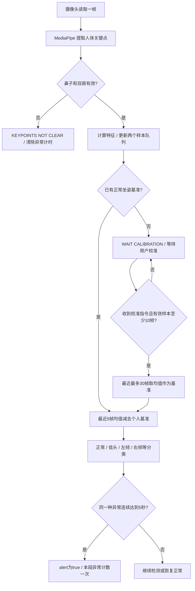

# 坐姿实测调准：逻辑、代码与操作流程

适用项目：智学灯；整理日期：2026-11-22。

后续更新：当前主程序已默认接入 1€ Filter，本文中的 5 帧均值作为保留的对照方案。特征、个人基准和提醒规则仍适用；默认平滑、参数、采样新格式和回放方法见 [OneEuro 算法接入与对照实验](OneEuro算法接入与对照实验.md)。

目标是让同一套算法适应当前使用者和摄像头位置，并用真实测试确定是否需要调整阈值。本次依据当前代码编写，配套提供 CSV 采样工具与无需摄像头的逻辑测试；**没有将模拟测试当作真人测试，也没有修改正式识别阈值。**

## 1. 这次主要测什么

摄像头固定在电脑上方，优先测试：正常、低头、向使用者自身左侧倾斜、向自身右侧倾斜。画面需要清楚显示鼻子和双肩，髋部可以不入镜。电脑或摄像头移动后，需要重新校准。

当前的 `LEAN FORWARD` 分支使用肩髋在图像中的横向偏移，不能充分代表身体向前倾；本轮先不把前倾作为可靠功能或验收结论。该分支仍存在于正式代码，没有在本次文档任务中关闭。

实测分为三件事：

1. **校准**：记录这个人在当前机位下的正常坐姿特征。
2. **分类验证与调参**：检查正常是否误判、异常是否漏判、左右方向是否正确。
3. **提醒验证**：确认同一种异常持续约 5 秒后提醒，恢复后能重新计时。

## 2. 当前程序的数据流



核心代码位置：

| 文件 | 作用 |
| --- | --- |
| [perception/posture.py](../perception/posture.py) | 模型识别、关键点检查、特征计算 |
| [edge/posture_judge.py](../edge/posture_judge.py) | 正常基准、平滑、分类、异常计时 |
| [main.py](../main.py) | 每帧调用、消费网页校准指令、更新网页状态和提醒逻辑 |
| [communication/web_app.py](../communication/web_app.py) | 接收网页请求，不直接完成校准 |
| [采样脚本](../tests/manual/collect_posture_samples.py) | 使用上述真实模块采集带标签的 CSV，不保存画面、不驱动外设 |
| [逻辑测试](../tests/test_posture_logic.py) | 用合成特征和模拟时钟核对规则，不代表识别精度 |

## 3. 如何得到“低头”和“倾斜”的数值

当前模型使用鼻子 0、左肩 11、右肩 12。只有三点的 `visibility > 0.5`，且归一化坐标算出的肩宽至少为 0.01，才返回有效特征。

以下是 `perception/posture.py` 中公式的简化写法，含义与现有实现一致：

```python
shoulder_y = (left_shoulder.y + right_shoulder.y) / 2
shoulder_width = np.sqrt(
    (left_shoulder.x - right_shoulder.x) ** 2
    + (left_shoulder.y - right_shoulder.y) ** 2
)

head_drop = (nose.y - shoulder_y) / shoulder_width
shoulder_tilt = (left_shoulder.y - right_shoulder.y) / shoulder_width
```

- 图像 y 坐标向下增加。鼻子相对肩部下移时，`head_drop` 往往增大。
- 左右肩高度差影响 `shoulder_tilt`；倾斜方向必须由使用者实际向左/右倾斜来核对，不能按观察屏幕者的左右猜测。
- 这些是归一化坐标构造的相对特征，**不是角度、厘米或真实三维姿态**。肩宽归一化有助于减轻距离变化的影响，但不能消除透视、转头、遮挡、画幅比例变化的影响。
- `person_detected` 实际依据是否得到有效特征；画面有人但肩部被裁掉时，它仍可能为 false。

## 4. 正常坐姿校准怎么做

实际步骤：机位固定 → 网页点击重新等待校准 → 自然坐正，让头肩完整入镜 → 保持约 5 秒 → 点击正常坐姿校准 → 检查状态及日志。

当前 `PostureJudge` 使用两个队列，关键点丢失时会清空它们，防止旧样本参与新的校准：

```python
self.history = deque(maxlen=5)              # 当前特征平滑
self.calibration_history = deque(maxlen=30) # 最近有效样本
```

核心校准逻辑是现有代码：

```python
def calibrate(self):
    if len(self.calibration_history) < 10:
        return False

    self.baseline = self.average_features(
        list(self.calibration_history)
    )
    self.reset_alert()
    return True
```

基准是最近最多 30 帧有效特征的均值。程序要求至少 10 帧有效样本，不是必须等待 10 秒。当前关键点丢失会清空样本重新积累，但程序仍不会自动判断使用者是否真的坐正、姿态是否稳定。固定等待 5 秒是操作建议；低帧率或关键点丢失时仍可能失败。

特别注意：

- 校准队列在校准后仍会更新。重新校准前应先重置，再坐正积累样本，避免将刚才的低头动作当作正常基准。
- 当前不会自动检验“你是否真的坐正”，操作时的姿态会被当作正常。
- 网页返回 `success: true` 只表示指令已接收，并带有 `command_id`。主循环执行后通过 `/api/status` 返回 `posture_command_id`、`calibration_result`、`calibration_message`、`calibrated` 与样本数量；网页等待匹配指令的结果，区分成功、失败和处理中。
- 调好后通常应能稳定显示 `NORMAL`。若一直是 `KEYPOINTS NOT CLEAR`，先调整取景和光照；不要先放宽异常阈值。

## 5. 分类规则与平滑

每帧先把最近最多 5 帧有效特征取均值，再与个人基准作差：

```python
current = self.average_features(self.history)
head_change = current["head_drop"] - self.baseline["head_drop"]
tilt_change = current["shoulder_tilt"] - self.baseline["shoulder_tilt"]

posture = "NORMAL"
if head_change > 0.15:
    posture = "HEAD DOWN"
elif tilt_change > 0.15:
    posture = "TILT LEFT"
elif tilt_change < -0.15:
    posture = "TILT RIGHT"
# 现有代码接着检查可选的肩髋偏移分支。
```

例如，正常基准 `head_drop=-0.35`，平滑后当前值为 `-0.12`，差值为 `0.23`，超过 0.15，判为低头。这里比较的是**相对个人基准的变化**，不是直接用原始 `head_drop` 与 0.15 比较。

低头优先于左右倾斜，同时低头和侧倾时当前只返回低头。阈值比较是严格大于/小于，等于边界时不触发对应分支。5 帧平滑可减轻抖动，也会带来动作开始与恢复时的延迟；它按帧数工作，不是固定的秒数窗口。

## 6. 5 秒提醒的准确含义

下面是现有 `update_alert()` 的核心部分：

```python
if self.abnormal_posture != posture:
    self.abnormal_posture = posture
    self.abnormal_start_time = time.monotonic()
    self.alert_triggered = False

elapsed = time.monotonic() - self.abnormal_start_time
if elapsed >= self.ALERT_DURATION and not self.alert_triggered:
    self.alert_triggered = True
    self.alert_count += 1
```

| 输入变化 | 当前行为 |
| --- | --- |
| 同一种异常持续不足 5 秒 | 已判异常，但尚未触发提醒 |
| 同一种异常达到 5 秒 | `alert=True`，次数增加 1 |
| 继续保持同一种异常 | `alert` 保持 true，次数不继续增加 |
| 恢复正常 | 清除异常计时和提醒标志；均值平滑可能使恢复稍有延迟 |
| 改成另一种异常 | 重新开始 5 秒计时；连续异常来回切换可能一直不提醒 |
| 关键点丢失 | 清除异常计时、实时特征与校准样本队列，保留已建立的个人基准 |
| 重置校准 | 清除基准、两个队列和计时，但不清除进程累计提醒次数 |

因此，计时规则是“**同一个异常类别连续 5 秒**”，不是“任意不良坐姿累计 5 秒”。人工从动作开始计时，还会包含平滑确认、处理循环和网页刷新延迟，不应要求屏幕上的提醒恰好在人工秒表 5.000 秒出现。

当前判断器的 `ALERT_DURATION=5.0` 是计时参数来源，运行控制模块直接引用判断器参数，`main.py` 保留引用别名用于兼容。网页提示文案仍按 5 秒展示，未来修改时要一起更新。

## 7. 真人实测顺序与记录表

先用一个人固定机位完成基础测试，再换人重新校准。以下为项目内部建议，不是教师新增评分要求。

| 用例 | 动作 | 预期结果 | 真人结果 |
| --- | --- | --- | --- |
| T01 | 重置后立即校准，有效样本不足 | 校准失败/仍等待，不应使用旧基准 | 待实测 |
| T02 | 自然坐正积累样本后校准 | 能进入并保持正常状态 | 待实测 |
| T03 | 正常坐姿保持约 60 秒 | 尽量稳定正常，记录误报次数及发生动作 | 待实测 |
| T04 | 低头保持至少 8 秒 | 分类为低头，算法连续异常约 5 秒后提醒一次 | 待实测 |
| T05 | 恢复正常，再次低头 | 清除提醒后重新计时，再增加一次提醒 | 待实测 |
| T06 | 自身左倾、右倾各保持至少 8 秒 | 方向对应正确，分别触发提醒 | 待实测 |
| T07 | 短暂低头约 2 秒，随后恢复 | 不触发提醒；记录平滑后的实际类别持续时间 | 待实测 |
| T08 | 低头与侧倾来回切换 | 记录计时被重置的现象，列为当前限制 | 待实测 |
| T09 | 离开、遮挡肩部后重新入镜 | 显示关键点不清晰；不沿用丢失前的异常计时 | 待实测 |
| T10 | 电脑/摄像头换位置 | 重新校准后重复正常及异常测试 | 待实测 |

每个主要异常至少重复 3 次。条件允许时，换 2–3 位使用者，在各自校准后复测。不能为了让镜头识别而夸张地弯腰或缩肩，再据此宣称日常场景有效。

## 8. 配套 CSV 采样代码怎么运行

脚本会直接调用正式的 `UpperBodyPose` 和 `PostureJudge`，先校准、再按指定时长采样。每次运行都要先坐正，看到 `SAMPLE_START` 后再做指定动作；不要在校准阶段就低头。

在树莓派项目目录执行以下命令。采样脚本需要独占摄像头，因此先停止网页服务；采样期间网页暂时不可访问。它不会自动替你停止后台服务，也不会连接蜂鸣器、台灯或正式数据库。

```bash
cd /home/hyz/smart_desk
systemctl --user stop smart-desk.service

# 正常样本：前5秒校准，随后继续坐正采样20秒。
.venv-pi/bin/python -u -m tests.manual.collect_posture_samples --label NORMAL --seconds 20

# 再次坐正校准；看到 SAMPLE_START 后开始低头。
.venv-pi/bin/python -u -m tests.manual.collect_posture_samples --label "HEAD DOWN" --seconds 20

# 左右都按使用者自身方向做动作，每次先完成正常校准。
.venv-pi/bin/python -u -m tests.manual.collect_posture_samples --label "TILT LEFT" --seconds 20
.venv-pi/bin/python -u -m tests.manual.collect_posture_samples --label "TILT RIGHT" --seconds 20

# 采样结束后恢复网页服务；中途失败或 Ctrl+C 后也需要执行此命令。
systemctl --user start smart-desk.service
```

默认追加到 `docs/test-results/posture_filter_samples.csv`，可用 `--output` 指定不同人员/轮次的独立文件；新格式增加了原始特征、基准、时间戳和参数，表头不兼容时拒绝混写。每秒输出一次状态摘要，结束打印基准与分类次数，不保存照片或视频。`NO PERSON` 标签用于先正常校准，再离开镜头的测试。

主要字段：

| 字段 | 用途 |
| --- | --- |
| `timestamp` / `elapsed_s` | 采样时间和本轮相对秒数 |
| `label` | 操作者声明的目标动作，不是自动生成的逐帧真实标签 |
| `valid` | 鼻子与双肩等特征是否有效 |
| `head_drop` / `shoulder_tilt` | 当前原始特征 |
| `head_change` / `tilt_change` | 正式判定使用的平滑特征相对基准的差值 |
| `posture` | 正式判断器给出的类别 |
| `alert_elapsed_s` / `alert` / `alert_count` | 异常持续时间、提醒状态与本进程累计提醒次数 |

无效特征帧的数值列留空，避免误当作 0。脚本记录不到摄像头完全读帧失败时的正常分类，会直接报错并释放资源。

切换动作需要时间，采样开始后的准备帧不能全部当作目标动作的真值。整理数据时应人工标记动作实际开始/结束的区间，再计算每类识别率、误报和延迟；脚本中的分类次数本身不是准确率。校准成功也只说明有足够样本，不保证姿态稳定或正确。

## 9. 拿到数据后如何调阈值

先确认头肩入镜、机位稳定、个人基准正确，再考虑改参数。当前参数位置如下：

| 参数 | 当前值与位置 | 调整影响 |
| --- | --- | --- |
| 关键点可见性 | `perception/posture.py` 的 `visible()`，0.5 | 放宽可能增加不可靠关键点，不能用于补救画面外的肩部 |
| 当前平滑队列 | `PostureJudge.__init__()`，5 帧 | 增大通常更平滑，也会增加响应延迟 |
| 校准队列/最低数量 | 同文件，最多 30 帧/至少 10 帧 | 需结合实际 FPS 和保持正常的时长评估 |
| 低头差值阈值 | `judge()`，0.15 | 增大减少敏感度，减小提高敏感度；需同时观察误报与漏报 |
| 左右倾斜差值阈值 | `judge()`，±0.15 | 左右分开看分布与方向，不要只测一侧 |
| 提醒时间 | 判断器与 `main.py`，5 秒 | 本轮先保持 5 秒，以便对齐现有演示与网页文案 |

可先比较正常样本 `head_change` 的上侧分布与低头样本的下侧分布；倾斜则分别比较正常与左、右样本。若正常和异常大量重叠，单纯调一个阈值通常不能解决，应重新检查特征、机位或分类定义。

示例仅说明选值方法：假设一组实测的正常差值 95 分位为 0.08，低头差值 10 分位为 0.22，可以将两者之间的值作为候选，再在独立一轮数据上验证。**这里的 0.08/0.22 是示意，不是已测结果，不应直接写进报告的实验表。** 调整时一次只改一项，记录旧值、新值、改善与退化，再换人员或另一天复测。

当前正式代码仍使用 0.15，并非已完成个性化阈值调优。本次采样脚本也不会自动修改代码或上线新的阈值。

## 10. 无摄像头的规则测试

配套测试复用真实 `PostureJudge`，用模拟时钟避免真的等待 5 秒，覆盖校准样本数量、三类异常、优先级、5 秒边界、持续异常只计一次、恢复再提醒、关键点丢失、异常类别切换及重置校准。

Windows 项目根目录：

```powershell
.\.venv\Scripts\python.exe -m unittest discover -s tests -p test_posture_logic.py -v
```

树莓派项目根目录：

```bash
.venv-pi/bin/python -m unittest discover -s tests -p test_posture_logic.py -v
```

逻辑测试不占用摄像头，不需要停止网页服务。测试会把“类别切换重计时、丢失时清空样本并保留基准、校准重置不清进程累计次数”等行为写明，方便修改规则时同步调整；它不表示这些边界已经是理想产品行为，也不能证明真人识别准确。

实测完成后，报告至少附上：机位与取景说明、参与者/轮次、校准方式、每类动作的有效区间、误报与漏报、触发延迟、FPS、参数版本和当前限制。真实蜂鸣器响铃仍需在驱动完成后单独验证。

## 11. 相关算法论文与本项目的对应关系

检索日期：2026-11-22。以下依据作者论文、原始预印本、期刊页面及作者算法页面整理。建议先看 [1]、[2]、[3]，考虑改进平滑时看 [4]；[5] 是有训练数据后的分类升级参考，[6] 用于报告相关工作。下面的迁移建议是针对本项目的工程判断，不是论文对当前系统效果的保证。

### [1] BlazePose：关键点提取的基础

**Bazarevsky, V., Grishchenko, I., Raveendran, K., et al. BlazePose: On-device Real-time Body Pose tracking. 2020. arXiv:2006.10204.**

[原文与 PDF 入口](https://arxiv.org/abs/2006.10204)

论文提出面向设备端实时运行的轻量姿态估计网络，输出单人的 33 个身体关键点，结合热图与坐标回归。它适合支撑报告中的“从图像提取骨架”的算法背景；当前 `perception/posture.py` 使用的 MediaPipe Pose 属于这条技术路线。

它本身不是完整的学习坐姿分类器，不会直接替我们定义正常、低头或 5 秒提醒。报告应区分使用预训练关键点模型与本组的特征、校准和提醒逻辑；论文的手机性能也不能写成树莓派的性能。

### [2] PoseTrack：与当前树莓派方案直接相关的应用论文

**Hsieh, Yung-Chen (Hailey), and Yu Sun. An Intelligent Mobile Application to Monitor and Correct Sitting Posture Using Raspberry Pi and MediaPipe Pose Detection. 2025. arXiv:2508.11683.**

[论文入口](https://arxiv.org/abs/2508.11683) · [全文](https://arxiv.org/html/2508.11683v1)

这是 arXiv 预印本。其系统使用树莓派、MediaPipe、Flask 和移动端反馈，通过摄像机视角与关节几何判断坐姿，并测试机位、光照和遮挡。与本项目的设备端识别、网页通信思路接近，适合参考整体结构和实验设计。

其几何判定用到相关关节及视角条件，一些动作依赖腿部、髋部等点，不能直接搬到当前只拍头肩的画面。它对关节遮挡的讨论也说明，增加算法复杂度不能代替有效取景。本文没有把我们的阈值 0.15 或连续 5 秒策略作为已验证参数。

### [3] 参考姿态比较：与“先校准、后比较”接近

**Aziz, M. H., and Mahmood, H. A. Automated Body Postures Assessment from Still Images Using Mediapipe. Journal of Optimization and Decision Making, 2023, 2(2): 240–246.**

[期刊原文](https://dergipark.org.tr/en/pub/jodm/article/1280121) · [全文 PDF](https://dergipark.org.tr/en/download/article-file/3071793)

其框架提取参考姿态与当前画面的关键点/特征，再作比较并给出纠正反馈。可用来说明参考姿态比较这类算法思路；与本项目的个人正常基准有联系。

区别是本项目使用多帧均值建立个人基准，并叠加实时平滑和异常持续时间判断，不是对该论文逐项复现。论文的主要侧视场景也不等同于我们的电脑顶部正面机位。

### [4] 1€ Filter：可考虑替代固定 5 帧均值的平滑算法

**Casiez, G., Roussel, N., and Vogel, D. 1€ Filter: A Simple Speed-based Low-pass Filter for Noisy Input in Interactive Systems. CHI 2012: 2527–2530. DOI: 10.1145/2207676.2208639.**

[作者页面与实现入口](https://gery.casiez.net/1euro/) · [原文 PDF](https://gery.casiez.net/publications/CHI2012-casiez.pdf)

它是按变化速度调整截止频率的一阶低通滤波方法：缓慢变化时重点抑制抖动，快速变化时提高响应速度。作者页面提供 Python 等语言的实现。

当前已将该算法接入 `head_drop`、`shoulder_tilt` 等特征，并保留 5 帧均值对照。参数需要按数据尺度和采样时间调节；目前完成了公式、回放和实机运行验证，尚未完成真人效果选优，不能据此认定准确率提高。

### [5] SitPose：用骨架特征训练坐姿分类器

**Jin, H., He, X., Wang, L., Zhu, Y., Jiang, W., and Zhou, X. SitPose: Real-Time Detection of Sitting Posture and Sedentary Behavior Using Ensemble Learning With Depth Sensor. 2024. arXiv:2412.12216.**

[预印本入口](https://arxiv.org/abs/2412.12216) · [全文](https://arxiv.org/html/2412.12216v1)

其方法从 Azure Kinect 的 3D 骨架提取关节角度等特征，组合 SVM、决策树和 MLP，通过软投票输出坐姿类别。适合参考“关键点 → 特征 → 分类器”的训练流程及对比实验。

它的深度相机输入与当前普通 USB 摄像头不同，不能直接使用其模型、数据精度或性能结论。若后续要增强本项目分类，可先收集带真实标签的头肩特征，用单个小型分类器与现有阈值方法比较，再决定是否需要集成模型；按人员或会话划分训练/测试，避免相邻视频帧随机分割造成结果虚高。这是本项目的迁移建议，不是原论文已验证的 RGB 头肩方案。

### [6] 坐姿识别与反馈综述：用于报告相关工作

**Krauter, C., Angerbauer, K., Calepso, A. S., Achberger, A., Mayer, S., and Sedlmair, M. Sitting Posture Recognition and Feedback: A Literature Review. CHI 2024. DOI: 10.1145/3613904.3642657.**

[作者机构公开全文 PDF](https://www.mmi.informatik.uni-muenchen.de/pubdb/publications/pub/krauter2024sittingposture/krauter2024sittingposture.pdf)

该综述覆盖识别硬件、反馈方式及用户研究，适合梳理视觉、压力传感器等不同路线，以及提醒方式如何评估。它是综述，不是可直接装进项目的单个分类算法，也不为当前系统提供医学效果保证。

### 建议本项目采用的路线

当前两种方案共用：**MediaPipe 关键点 → 肩宽归一化特征 → 个人基准 → 可选平滑 → 阈值分类 → 连续异常提醒**。主程序默认 1€ Filter，5 帧均值保留对照；仍需真人数据确定参数与效果。

| 可做的对照 | 比较内容 | 建议修改位置 |
| --- | --- | --- |
| 无个人校准 / 有个人校准 | 不同人员的正常误报和异常漏报 | `PostureJudge.baseline` 与差值计算 |
| 现有 5 帧均值 / 1€ Filter | 静止抖动、动作确认与恢复延迟、CPU 耗时 | `average_features()` 附近的实时特征平滑流程 |
| 阈值分类 / 小型特征分类器 | 每类召回、混淆矩阵、跨人/跨会话泛化 | `judge()` 中的分类部分 |

论文可以支撑算法选择，但现有 0.15 阈值、10/30 帧校准和 5 秒提醒仍是本项目的工程设定，需要自己的数据与实验说明。新增论文参考不代表已经修改正在运行的算法。

## 12. 代码补全后的统计与故障行为

控制与计时已提取到 `services/runtime.py`，摄像头采集放入 `services/camera_worker.py`。读帧失败或卡住时，超过约 2 秒未更新的画面判为离线，控制与计时仍可运行，采集线程会尝试重开设备。模型推理仍在主循环中，不等于实现了推理进程卡死的独立看护。

网页 `reminder_count` 现在表示当前学习会话的新提醒次数，保存重置后归零；从开始到保存之间，包括暂停和休息期间，仍监测并记录新提醒。未开始会话时不把提醒混入学习记录。`total_reminder_count` 是本进程累计值；采样脚本直接记录判断器的进程累计值，两者口径需区分。

本次没有改动 0.15 阈值、5 秒提醒或异常类别切换重计时规则，也没有宣称完成真人准确率实验。具体改动与验证见[代码补全执行记录](代码补全执行记录.md)。
